<div align="center">

# EVEXIA · Astronaut Health Monitoring Console

**Crew health decision support that knows where you are, how far Earth is, what normal looks like *for you*, and what your wearables are saying right now.**


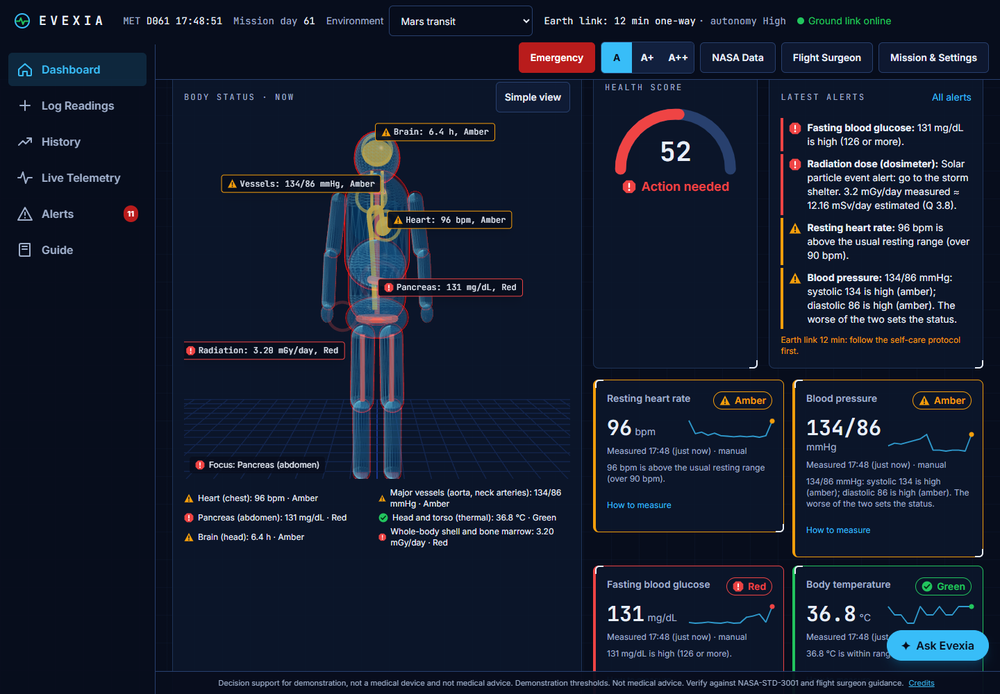

</div>

> **Disclaimer.** Evexia is decision support for demonstration. It is **not a medical device and not medical advice**. Heart-rate, blood-pressure, upper glucose and fever bands are demonstration values; verify every threshold against NASA-STD-3001 and flight surgeon guidance before any real use.

---

## Contents

1. [The problem](#1-the-problem)
2. [Our solution](#2-our-solution)
3. [Features](#3-features)
4. [How it works](#4-how-it-works)
5. [Real NASA data](#5-real-nasa-data)
6. [Health indicators and thresholds](#6-health-indicators-and-thresholds)
7. [Score and severity logic](#7-score-and-severity-logic)
8. [Wearable telemetry](#8-wearable-telemetry)
9. [3D body](#9-3d-body)
10. [Environments and comms delay](#10-environments-and-comms-delay)
11. [AI assistant](#11-ai-assistant)
12. [Accessibility](#12-accessibility)
13. [Tech stack and project structure](#13-tech-stack-and-project-structure)
14. [Getting started](#14-getting-started)
15. [Demo walkthrough (2–3 minutes)](#15-demo-walkthrough-23-minutes)
16. [Testing](#16-testing)
17. [Screenshots](#17-screenshots)
18. [Limitations](#18-limitations)
19. [Roadmap](#19-roadmap)
20. [Sources and references](#20-sources-and-references)
21. [Credits and licences](#21-credits-and-licences)
22. [Team and acknowledgements](#22-team-and-acknowledgements)

---

## 1. The problem

Long-duration missions expose crews to the five hazards of human spaceflight described by NASA's Human Research Program: **space radiation, isolation and confinement, distance from Earth, altered gravity fields, and hostile closed environments**. On the ISS a flight surgeon is a real-time call away. On the way to Mars a message takes **up to 20 minutes one way**, so the crew must notice, interpret and act on health changes themselves.

Astronauts need a tool that turns readings, whether typed in or streamed from wearables, into a clear status, plain-language guidance, a health history and a well-structured report for the ground, and that changes its behaviour as Earth gets further away.

Challenge: NASA Space Apps Challenge 2026, *Health Monitoring Software*: <https://www.spaceappschallenge.org/> *(exact challenge page URL to be verified)*.

## 2. Our solution

Evexia is a NASA-style crew health console. Every reading is a **timestamped log entry** (date, time, source and details), entered by hand or synced from **real-time wearable telemetry**. Each indicator is classified **green / amber / red** and shown on a **3D human body**. A health score updates, the app explains what each result means, recommends actions, links findings to spaceflight hazards, keeps a **history of the past weeks**, and decides when to escalate, including a one-tap **emergency mode**.

**What makes it different**

| | Feature | What it does |
|---|---|---|
| ⌚ | **Live wearable telemetry** | Pairs with real Bluetooth health devices (heart-rate straps and watches, thermometers, blood-pressure cuffs) and accepts real-time data from device gateways through an API. Samples stream live to the screen and **sync to the log** to update the evaluation. |
| 📡 | **Comms-delay autonomy** | The Earth-link delay changes behaviour. Above 5 min the **self-care protocol comes first** and escalations say "message will arrive in X min". Short delay recommends escalating amber findings early. |
| ☢️ | **Real radiation science** | Dosimeter readings are logged as measured **absorbed dose (mGy)** and converted to estimated **effective dose (mSv)** for NASA's limits (600 mSv career, 250 mSv per solar event). The app shows **real NASA RadLab measurements**, including Curiosity's solar storm on 20 May 2024, and **live solar events from NASA DONKI**. |
| 🧬 | **Personal baseline + hazard correlation** | Readings can be judged against the astronaut's own pre-flight baseline. Rules link combinations to the five HRP hazards (e.g. short sleep + raised heart rate + 14+ days without a private conference → *isolation and confinement: behavioural health risk*). |

## 3. Features

| Screen | What you get |
|---|---|
| **Dashboard** | Current status as of now: 3D body, six indicator cards (value, status, **when and how it was measured**, sparkline), health score, latest alerts, live-wearable strip, cumulative and solar-event dose, hazard insights and the latest log entries. Readings older than 36 h are flagged "out of date" and not counted. A red finding offers **Emergency mode**. |
| **Log Readings** | **Date and time** (defaults to now; back-dating allowed, future rejected) with mission day, then each indicator with a number field **and** slider kept in sync, live status preview, the last logged value, inline validation, a **details** field (symptoms, activity, context), the solar-event flag and recent entries. |
| **History** | Trends over the **past week, 2 weeks, 4 weeks or all**: daily health score, one chart per indicator with green/amber/red bands and shape-coded points, a **weekly summary** table (averages and amber/red counts), the full **log table** (date, time, mission day, source/device, values with status, details), a source filter, delete and **CSV export**. |
| **Live Telemetry** | Live tiles per metric with time, device and status; stream status; **Sync to log now** with a preview of exactly what will be logged; **auto-sync** every 15/30/60 min; **Bluetooth pairing**; gateway API instructions; devices seen. |
| **Alerts and Guidance** | Each alert: severity, meaning, why it matters in spaceflight, recommended actions, self-care protocol (first when delay is long), countermeasure, sources, **Escalate to flight surgeon**. |
| **Emergency mode** | One tap from the header. Earth-link timing, current readings, situation checklists (cardiac, unresponsive crewmate, low blood sugar, fever or hypothermia, radiation storm) and a **priority emergency report**; ticked steps go in as "actions taken". |
| **NASA Data** | Live DONKI solar particle events and flares, the real Curiosity RAD storm chart, measured dose by environment (ISS, lunar orbit, Mars surface), the published limits Evexia uses, and **what is not verified**. |
| **Escalation report** | Structured report with each reading's **measurement time and source**, severities, hazard insights, dose estimates, actions and note. Preview, copy, **.txt**, **PDF**, send. |
| **Measurement Guide** | Per indicator: what it is, why it matters in space, on-board device, steps, normal range, when to worry, sources. |
| **Flight Surgeon** | Crew status from each member's latest logs, last-log time, incoming escalations (emergencies first), mark reviewed and notes. |
| **Mission & Settings** | Environment, Earth-link delay, crew member, mission start date, last private conference, prior career dose, telemetry key, personal baseline, accessibility. |
| **Assistant** | Docked chat. Claude via the server, or **Offline guidance mode** (rule-based). |

## 4. How it works

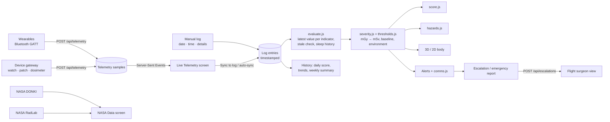

All decision logic is in pure, unit-tested modules in `client/src/lib/` (`severity`, `score`, `hazards`, `comms`, `evaluate`, `telemetry`, `escalation`). The server imports the same modules, so it validates data and builds assistant context with exactly the rules the crew sees. The client is **offline-first**: logs save locally immediately, are marked "Not yet sent to ground", and sync when the link returns.

## 5. Real NASA data

The challenge resources explain the risks; the real numbers come from one click deeper. Evexia uses them directly:

| Source | What Evexia uses | How |
|---|---|---|
| **NASA OSDR RadLab** ([site](https://visualization.osdr.nasa.gov/radlab/)) | Measured absorbed dose rate (µGy/h): **Curiosity RAD on Mars, 14–26 May 2024**; ISS DosTel (15 May 2024); LRO CRaTER lunar orbit (1 Mar 2012) | `npm run data:nasa` queries `https://visualization.osdr.nasa.gov/radlab/api/` and writes provenance-tagged JSON to `server/data/nasa/` (bundled, works offline) |
| **NASA CCMC DONKI** ([site](https://ccmc.gsfc.nasa.gov/tools/DONKI/)) | Solar particle events and flares, last 30 days | `GET /api/space-weather` proxies `https://ccmc.gsfc.nasa.gov/DONKI/WS/get/SEP` and `/FLR` (no key), cached 15 min, bundled snapshot as fallback |
| **NASA-STD-3001** | 600 mSv career effective dose; 250 mSv per solar particle event; 8.5 h recommended sleep period; hypothermia below 35 °C | Limits in `thresholds.js` |
| **OSDR Inspiration4 crew blood results** | Fasting glucose lab normal range **65–99 mg/dL** | Glucose green band |

**The real storm.** RadLab's Curiosity data shows the 20 May 2024 solar storm: the daily mean absorbed dose rate rose to **69.34 µGy/h, 16.5× the 4.21 µGy/h mean of 14–19 May** (about 18× the day before), peaking at **304 µGy/h**, and was back near normal within two days. The NASA Data screen charts the hourly values.

**Units.** Dosimeters measure **absorbed dose (mGy)**. NASA's limits are **effective dose (mSv)**, which also weights how harmful each particle type is, so the two numbers differ for the same day. Evexia logs and shows the measured mGy and estimates mSv with an environment quality factor (approximate, to be verified) only for comparison with the limits.

## 6. Health indicators and thresholds

All limits live in **`client/src/config/thresholds.js`**.

| Indicator | Unit | Green | Amber | Red | Basis |
|---|---|---|---|---|---|
| Resting heart rate | bpm | 50–90 | 40–49 or 91–100 | < 40 or > 100 | Demonstration values, to be verified |
| Blood pressure | mmHg | 95–129 / 60–84 | 130–139 / 85–89, or sys 90–94 | ≥ 140/90 or < 90/60 | Demonstration values (worse of systolic/diastolic) |
| Fasting glucose | mg/dL | **65**–99 | 60–64 or 100–125 | < 60 or ≥ 126 | Lower bound from Inspiration4 lab range (OSDR); upper bands demo |
| Body temperature | °C | 36.1–37.2 | **35.0**–36.0 or 37.3–38.0 | **< 35.0** (hypothermia) or > 38.0 | Hypothermia from NASA-STD-3001; fever bands demo |
| Sleep | h/night | ≥ 7 | 6–6.9 (or one night 5–5.9) | < 6 two nights running, or < 5 once | NASA-STD-3001 recommends an 8.5 h sleep *period* |
| Radiation (dosimeter) | **mGy/day** absorbed | est. mSv below env. limit (0.8 LEO, 1.9 Mars transit) | est. up to 2.0 mSv/day | est. > 2.0 mSv/day or solar particle event | Estimated effective dose vs NASA-STD-3001 limits |
| Cumulative dose | % of 600 mSv | < 50 % | 50–80 % | > 80 % | NASA-STD-3001 career limit |
| Solar-event dose | % of 250 mSv | < 20 % | 20–80 % | ≥ 80 % | NASA-STD-3001 per-event limit |

NASA publishes **no** green/amber/red limits for heart rate, blood pressure, glucose or fever, and there is no open astronaut vital-sign dataset; those bands stay labelled **"to be verified"** in the UI.

**Personal baseline mode:** > 15 % deviation amber, > 25 % red; absolute red limits always win. Temperature uses ±0.6 / ±1.0 °C; sleep counts only shortfall; radiation is never baseline-adjusted.

## 7. Score and severity logic

Each indicator returns `{ value, severity, reason, sources }`. The **current status** uses the most recent non-stale value of each indicator (36 h window). Sleep red uses the latest sleep value of each earlier calendar day.

Weights: heart rate 20, blood pressure 20, sleep 20, glucose 15, radiation 15, temperature 10. Points green 100, amber 60, red 20; **score = weighted average**, **capped at 59 if anything is red**. Bands: 85–100 Nominal, 60–84 Watch, < 60 Action needed. History plots the score at the end of each day.

## 8. Wearable telemetry

**Three ways in, one pipeline.** Every sample (metric, value, timestamp, device) goes to `POST /api/telemetry`, is stored, and is pushed live over **Server-Sent Events** (`GET /api/telemetry/stream?crewId=`).

1. **Bluetooth (Web Bluetooth, Chrome/Edge on desktop and Android, HTTPS or localhost).** Standard Bluetooth SIG health profiles, so real devices work without vendor SDKs:

   | Profile | GATT service / characteristic | Typical devices |
   |---|---|---|
   | Heart Rate | 0x180D / 0x2A37 | Chest straps (e.g. Polar H10), watches in heart-rate broadcast mode |
   | Health Thermometer | 0x1809 / 0x2A1C (IEEE-11073 FLOAT, °C/°F) | Clinical BLE thermometers |
   | Blood Pressure | 0x1810 / 0x2A35 (IEEE-11073 SFLOAT, mmHg/kPa, pulse) | BLE blood-pressure cuffs |

2. **Device gateway API.** Watches, rings, patches and dosimeters that sync through a phone or habitat gateway push samples in real time:

   ```bash
   curl -X POST https://<host>/api/telemetry \
     -H "Content-Type: application/json" \
     -H "x-telemetry-key: $TELEMETRY_KEY" \
     -d '{"crewId":"c1","deviceId":"watch-01","deviceName":"Crew smartwatch",
          "samples":[{"metric":"hr","value":72,"ts":"2026-11-14T07:30:00Z"}]}'
   ```
   Metrics: `hr`, `sys`, `dia`, `glucose`, `temp`, `sleep`, `radiation` (mGy/day). Up to 1000 samples per request; future timestamps rejected; `TELEMETRY_KEY` enables key authentication.

3. **Simulator (developer tool only).** `npm run telemetry:sim -- --crew c1 --minutes 10` drives the same gateway API with realistic samples, so the screen can be tried without hardware.

**Sync to log.** On the Live Telemetry screen (or automatically every 15/30/60 min) the window is turned into a log entry: **heart rate = median of the window** (a resting estimate that ignores spikes), every other metric = its latest sample, blood pressure only as a sys/dia pair. The entry records the devices, time range and sample counts in its details, is tagged *Wearable sync*, and immediately updates the status, body, score and alerts. Raw samples are kept for 7 days (`TELEMETRY_RETENTION_DAYS`); log entries are permanent.

## 9. 3D body

A **status display, not a click menu**: the affected region glows, pulses by severity, shows a floating label (*"Heart: 96 bpm, Amber"*) and a ring; the camera eases to the worst region and back. Orbit controls stay available. Colour is always paired with a shape and text.

| Reading | Region (mesh name) |
|---|---|
| Heart rate | `heart` |
| Blood pressure | `vessels` (aorta, neck arteries) |
| Glucose | `pancreas` |
| Temperature | `skin_shell` thermal tint |
| Sleep | `brain` |
| Radiation | `radiation_shell` fresnel glow + bone marrow in `skeleton` |

Reduced motion gives a static glow; software WebGL is detected and frame-capped; **Simple view** / no WebGL gives a 2D SVG body; a text list of regions is always rendered for screen readers. The 3D chunk is lazy-loaded.

**Model:** this build ships the **primitive fallback body** with the final mesh names. To use a real anatomy model, process it (decimate, name meshes as above, < 10 MB, meshopt/Draco) to `client/public/models/body.glb`. Sources: Z-Anatomy (CC BY-SA 4.0), BodyParts3D (**CC BY 4.0**), NIH 3D (CC-BY).

## 10. Environments and comms delay

| Environment | Measured absorbed dose (RadLab) | Quality factor (est.) | Green limit | One-way delay | Autonomy |
|---|---|---|---|---|---|
| Space station (LEO) | ~0.43–0.54 mGy/day (ISS DosTel) | 2.0 | 0.8 mSv/day | ~0 s | Low |
| Lunar base / Rover | ~0.20 mGy/day (LRO CRaTER, lunar orbit) | 3.0 | 1.6 mSv/day | 1.3 s | Medium |
| Mars transit | no RadLab data; literature ≈0.48 mGy/day (to be verified) | 3.8 | 1.9 mSv/day | 4–20 min (default 12) | High |
| Mars surface | ~0.10 mGy/day quiet days (Curiosity RAD, May 2024) | 3.0 | 0.8 mSv/day | 4–20 min | High |

Above 5 minutes: self-care protocol first, escalation marked "message will arrive in X min", emergency mode says not to wait for a reply.

## 11. AI assistant

`POST /api/assistant` calls the **Claude API** through the official Anthropic SDK (key server-side only, `ANTHROPIC_MODEL` default `claude-sonnet-5-5`, capped `max_tokens`, low effort, rate-limited). The server recomputes severities from raw readings and sends environment, delay, mission day and per-indicator status, including the mGy → mSv conversion. Safety rules: plain language, practical self-care, **never diagnose**, **always escalate red**, respect comms delay, flag emergencies, no invented numbers. Refusals, missing key, network or API errors all fall back to the **rule-based guidance** (badge: *Offline guidance mode*).

## 12. Accessibility

44 px touch targets; high-contrast theme; three text sizes; full keyboard navigation with visible focus and a skip link; landmarks and labels; status by colour + shape + text everywhere (cards, tables, charts, body); reduced motion; screen-reader body summary and chart summaries; `aria-live` updates. **axe-core: zero serious or critical violations** on all 11 screens, in high-contrast mode and with the assistant open; no horizontal scroll at 360/768/1440 px.

## 13. Tech stack and project structure

**Frontend:** React 18, Vite 5, Tailwind CSS 3, React Router 6, Zustand 4, Recharts 2, three.js + @react-three/fiber + drei, Web Bluetooth, EventSource, jsPDF (lazy).
**Backend:** Node.js + Express 4, Server-Sent Events, express-rate-limit, Anthropic TypeScript SDK, SQLite via **better-sqlite3** (automatic fallback to `node:sqlite`).
**Testing:** Vitest (unit + API with supertest), Playwright (e2e), @axe-core/playwright.

```
evexia/
├─ README.md · TEST_REPORT.md · .env.example · render.yaml · playwright.config.js · LICENSE
├─ client/src/
│  ├─ routes/       Dashboard, LogReadings, History, Telemetry, Alerts, Guide, Emergency,
│  │                NasaData, Settings, Surgeon, Credits
│  ├─ components/   Body3D, Body2D, BodyView, IndicatorCard, LogTable, TrendChart, ScoreGauge,
│  │                AlertCard, HazardPanel, EscalationDialog, AssistantPanel, Layout, …
│  ├─ lib/          severity, score, hazards, comms, evaluate, telemetry, bluetooth,
│  │                escalation, ruleAssistant, format, api
│  ├─ hooks/        useTelemetry (SSE stream, auto-sync)
│  ├─ config/thresholds.js · content/ (guide, guidance, hazards) · store/useHealthStore.js
│  └─ tests/        Vitest unit tests (client/tests)
├─ server/
│  ├─ index.js · app.js · seed.js · db/ (schema, repository) · lib/ (assistant, spaceWeather, sampleLogs)
│  ├─ scripts/      fetch-nasa-data.js (RadLab + DONKI), simulate-wearable.js
│  ├─ data/nasa/    radlab-msl-mars-may2024.json, radlab-reference.json, donki-snapshot.json
│  └─ tests/api.test.js
├─ e2e/             evexia.spec.js, a11y.spec.js, screenshots.spec.js, global-setup.js
└─ docs/screenshots/
```

## 14. Getting started

**Prerequisites:** Node.js **20+** (22 LTS recommended; tested on Node 26), npm 10+.

```bash
npm install
cp .env.example .env     # optional: ANTHROPIC_API_KEY, TELEMETRY_KEY
npm run seed             # crew, baselines and 21 days of sample log history (tagged "sample")
npm run dev              # API :8787 + web app http://localhost:5173
npm run telemetry:sim    # optional: stream simulated wearable data into the running app
```

| Command | What it does |
|---|---|
| `npm run dev` | API (watch) + Vite dev server with `/api` proxy |
| `npm run seed` | Rebuild the database (`SEED_DAYS=0` for no sample history) |
| `npm run data:nasa` | Refresh bundled RadLab and DONKI data from NASA |
| `npm run telemetry:sim -- --crew c1 --minutes 10` | Wearable gateway simulator (dev tool) |
| `npm run build` / `npm start` | Production build / start (serves `client/dist` + API on one host) |
| `npm run lint` · `npm test` · `npm run test:e2e` | Lint · unit + API tests · e2e + accessibility |

**Environment variables** (`.env.example`): `PORT`, `ANTHROPIC_API_KEY` (server only), `ANTHROPIC_MODEL`, `ASSISTANT_MAX_TOKENS`, `ASSISTANT_TIMEOUT_MS`, `ASSISTANT_RATE_LIMIT`, `DATABASE_PATH`, `CORS_ORIGIN`, `SERVE_CLIENT`, `TELEMETRY_KEY` (require `x-telemetry-key` on ingest), `TELEMETRY_RETENTION_DAYS`, `DONKI_BASE_URL`, `SEED_DAYS`, and client-side `VITE_API_URL`.

> **npm 11+/12:** install scripts are blocked by default; Evexia still works (the server falls back to `node:sqlite`). To allow them: `npm install-scripts approve better-sqlite3 esbuild`.

### Deploy

**Single host on Render (recommended):** `render.yaml` Blueprint builds the client, seeds, and runs `npm start` (API + client on one HTTPS origin, which Web Bluetooth and SSE need). Set `ANTHROPIC_API_KEY` and `TELEMETRY_KEY` in the dashboard; add a disk + `DATABASE_PATH` to keep logs across deploys.
**Vercel + Render:** API on Render with `SERVE_CLIENT=false` and `CORS_ORIGIN=https://<app>.vercel.app`; Vercel root `client`, `VITE_API_URL=https://<api>.onrender.com`.
Then open the public URL in a private window and request **FortiGuard Web Filter classification** (web-based application; company N/A).

## 15. Demo walkthrough (2–3 minutes)

1. **(0:00) Dashboard.** Health status *as of now*: 3D body, cards showing when and how each value was measured, live-wearable strip, latest log entries.
2. **(0:20) Live Telemetry.** Run `npm run telemetry:sim` (or pair a Bluetooth strap). Heart rate ticks live; devices appear. Press **Sync to log now**: the preview becomes a *Wearable sync* entry and the dashboard updates.
3. **(0:50) Log a reading.** Date and time default to now; type heart rate **96** (slider follows), glucose **130**, add details "Fasting, slight headache". Save: chest amber, pancreas red, score capped, emergency prompt.
4. **(1:15) Alerts.** On Mars transit (12 min) the **self-care protocol is first**; escalate and download the PDF report with measurement times.
5. **(1:35) History.** Switch past week / 2 / 4 weeks: daily score dips during the sleep-loss week and the solar event; weekly summary; every log with date, time and details.
6. **(2:00) NASA Data.** Live DONKI flares, and the **real Curiosity storm of 20 May 2024** (16.5× normal). Explain mGy vs mSv.
7. **(2:20) Emergency.** Header **Emergency** → radiation-storm checklist → **Send emergency report** → Flight Surgeon view lists it first.
8. **(2:40) Accessibility.** Simple view (2D), text size A++, keyboard navigation.

## 16. Testing

```bash
npm run test:unit     # 133 tests: thresholds, severity, mGy→mSv, score, hazards, comms, log evaluation,
                      #            history series, BLE parsers, telemetry sync, assistant, reports
npm run test:api      # 46 tests: every route incl. telemetry ingest/auth, SSE stream, DONKI (mocked + fallback), RadLab
npm run test:e2e      # builds the client, starts a fresh single-host server, runs e2e + axe + responsive + perf
```

Every e2e test also fails on any browser console error. On Windows the tests use full Chromium with the real GPU (`E2E_GPU=0` forces software WebGL). Regenerate screenshots with `SCREENSHOTS=1 npx playwright test e2e/screenshots.spec.js`. See **[TEST_REPORT.md](TEST_REPORT.md)**.

## 17. Screenshots

| | |
|---|---|
| 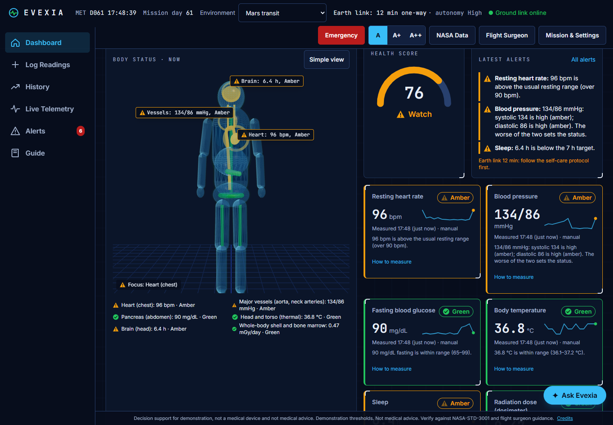 Status: amber heart, vessels, brain |  Solar particle event and high glucose |
| 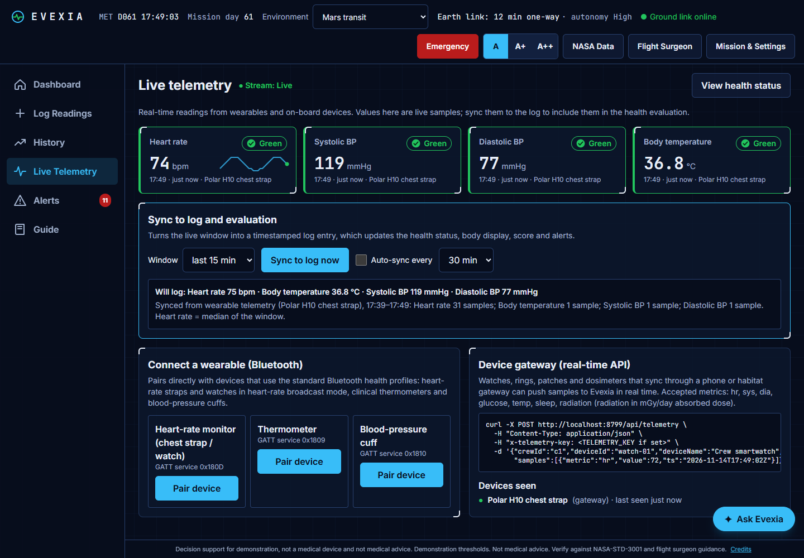 Live wearable telemetry and Sync to log | 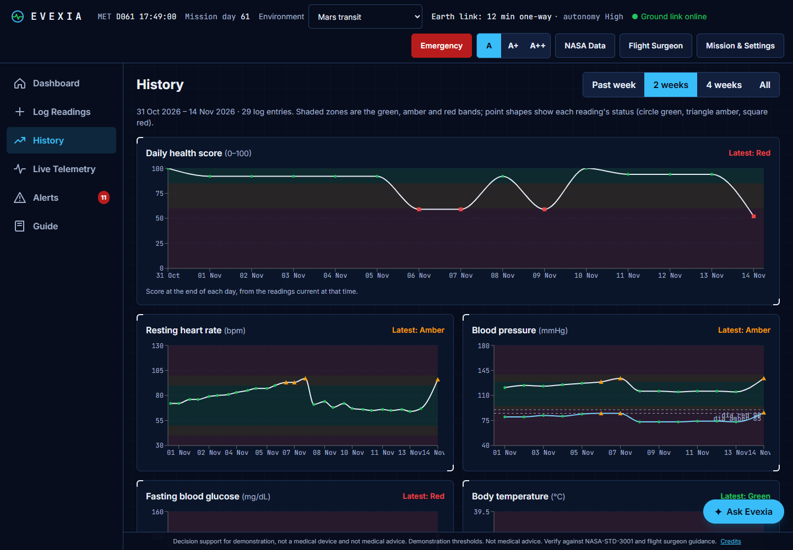 History: weekly trends and log |
| 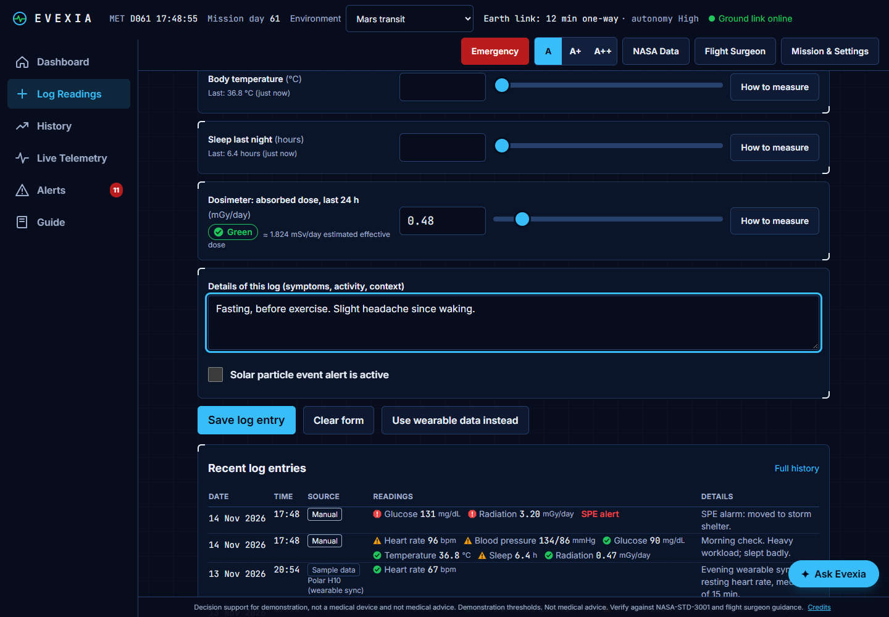 Log entry with date, time and details | 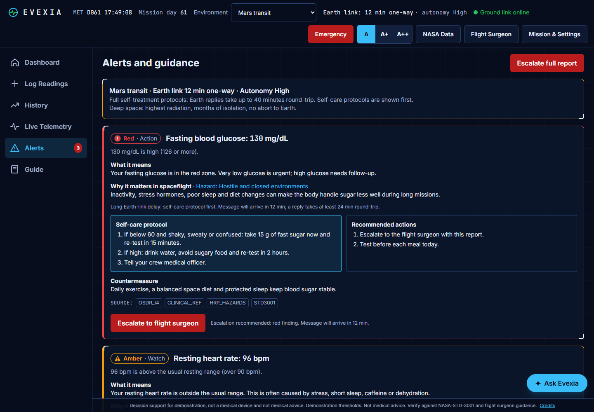 Alerts: self-care first on Mars transit |
| 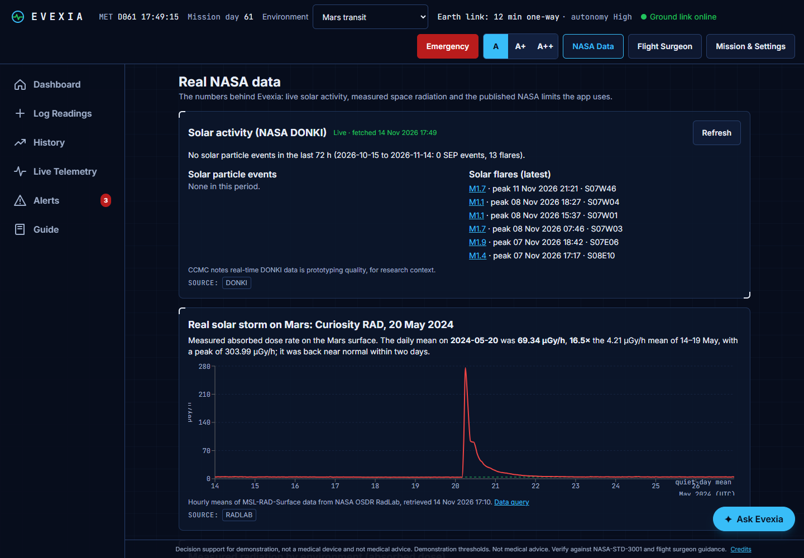 Real NASA data: DONKI and Curiosity RAD | 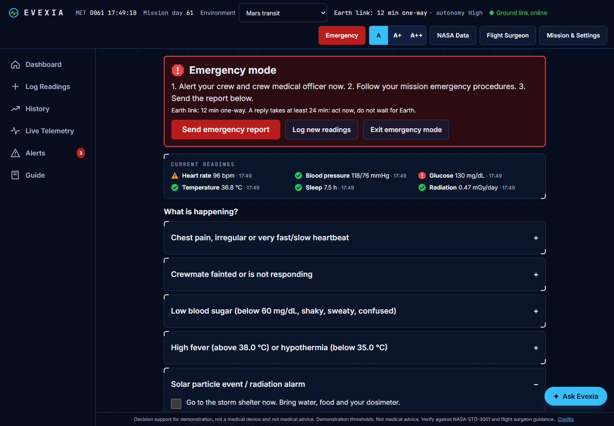 Emergency mode |
| 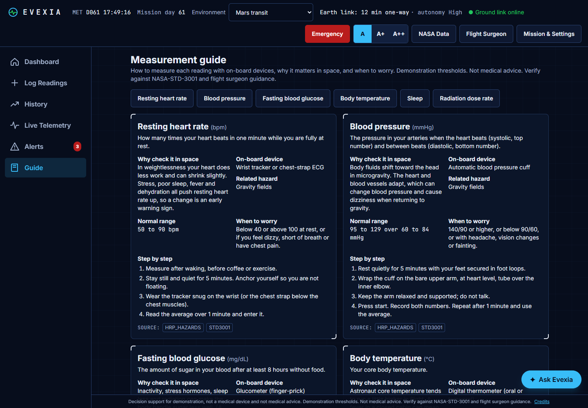 Measurement Guide | 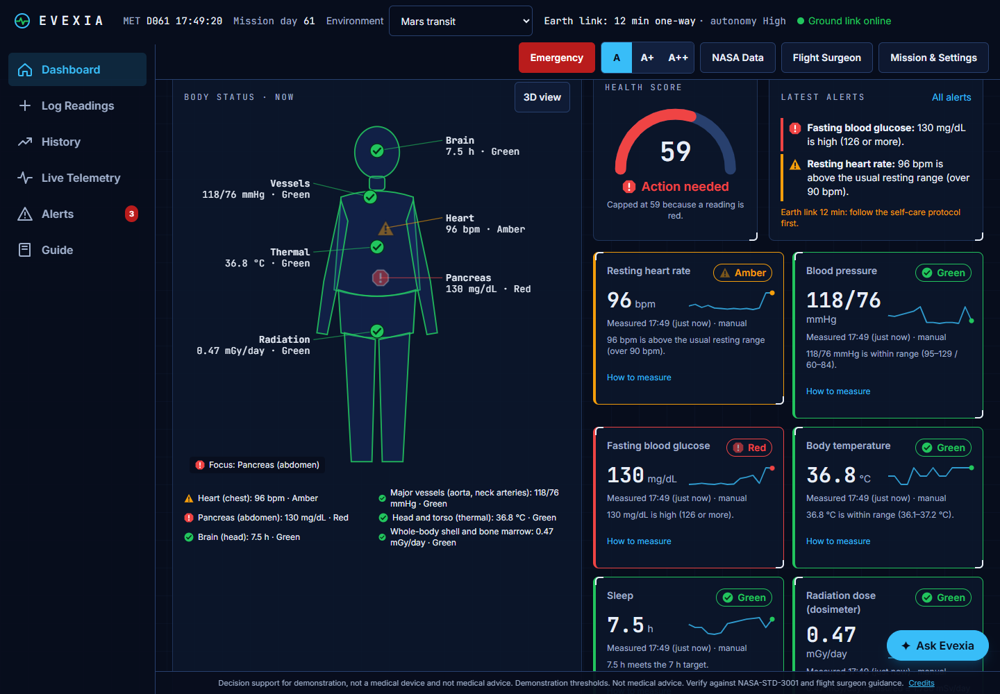 2D simple view |

## 18. Limitations

- **Not a medical device.** Heart-rate, blood-pressure, upper-glucose and fever bands are demonstration values (NASA publishes none).
- mGy → mSv uses approximate environment quality factors (to be verified); a dosimeter that reports dose equivalent directly would be more accurate.
- NASA-STD-3001 figures and the Inspiration4 range come from team research and their page URLs are marked "to be verified"; the Mars-surface 0.67 mSv/day, Chang'E-4 and ISS-range figures from that research were not opened, so the app uses RadLab measurements instead.
- Web Bluetooth works in Chrome/Edge (desktop, Android) only and was verified with byte-level parser tests, not with physical devices during the build. Proprietary-only devices need a gateway.
- The brief's "HR 108 → amber" conflicts with its own table (> 100 = red); Evexia follows the table.
- The Claude path is verified with mocked SDK responses and an unreachable-endpoint test, not live (no key during the build).
- No authentication on the flight-surgeon view; telemetry auth is a shared key (demo scope).
- The sample history (21 days) is generated and tagged *Sample data*; delete it from History or seed with `SEED_DAYS=0`.

## 19. Roadmap

Per-device pairing records and wearable vendor integrations (Apple HealthKit, Garmin, Oura via gateway) · SpO₂, HRV and skin temperature · crew authentication and ground sync · mood and cognitive checks · anatomy GLB · multi-language UI · PWA with background sync.

## 20. Sources and references

- NASA OSDR RadLab and its data API: <https://visualization.osdr.nasa.gov/radlab/> · <https://visualization.osdr.nasa.gov/radlab/gui/data-api/> (queried during the build)
- NASA CCMC DONKI: <https://ccmc.gsfc.nasa.gov/tools/DONKI/> (web service queried during the build)
- NASA-STD-3001 Space Flight Human-System Standard: <https://www.nasa.gov/ohcm/nasa-std-3001/> *(to be verified)*
- NASA OSDR (Inspiration4 crew data): <https://osdr.nasa.gov/bio/repo/> *(study URL to be verified)*
- NASA HRP hazards: <https://www.nasa.gov/hrp/hazards/> · *The Human Body in Space*: <https://www.nasa.gov/humans-in-space/the-human-body-in-space/> *(to be verified)*
- Bluetooth SIG GATT specifications: Heart Rate, Health Thermometer and Blood Pressure profiles.
- NASA Space Apps Challenge 2026: <https://www.spaceappschallenge.org/> *(challenge page to be verified)*

## 21. Credits and licences

Code: **MIT**. 3D body: original three.js primitives (MIT). Planned models: Z-Anatomy (CC BY-SA 4.0), BodyParts3D (CC BY 4.0), NIH 3D (CC-BY); any bundled model keeps its own licence. NASA data (RadLab, DONKI, OSDR) is public NASA data; CCMC notes DONKI real-time data is prototyping quality. three.js, React, Recharts, Zustand, Vite, Tailwind, Express, jsPDF, better-sqlite3, Anthropic SDK (MIT). Fonts: Inter, JetBrains Mono (SIL OFL 1.1).

## 22. Team and acknowledgements

Built for the **NASA Space Apps Challenge 2026**, *Health Monitoring Software*. *(Add team member names and roles here.)* Thanks to NASA's Human Research Program, the OSDR RadLab and CCMC DONKI teams, and the BodyParts3D, Z-Anatomy and NIH 3D projects.
